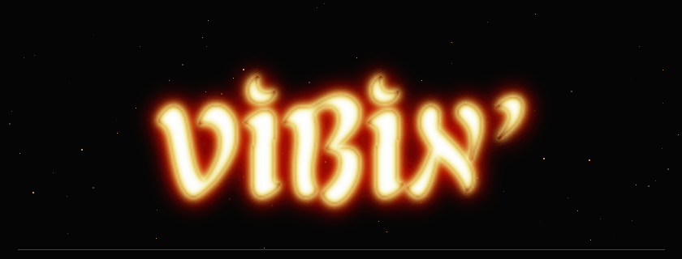

<p align="center">
  
  <br />
  
</p>

```text
┌─ VIBIN'.NFO ───────────────────────────┐
│                                        │
│  METHOD .......... make no mistakes    │
│  IMPLEMENTATION .. auto mode           │
│  CODE REVIEW ..... looks good to me    │
│                                        │
└─────────────────────── end of file ────┘
```

---

<p align="center">
  
  
  
</p>

<!-- Logo made with CoolText: https://cooltext.com/ -->
<!-- Original web buttons from ComfyBox: https://comfybox.floofey.dog/ -->
